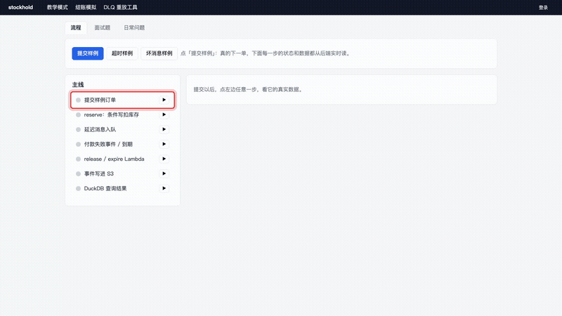
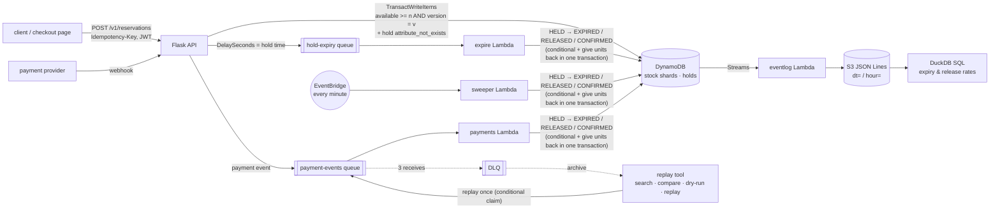

# stockhold

**An inventory reservation service: hold stock for a pending order, confirm it when payment succeeds, release it when payment fails or the hold times out — and never sell more units than exist, however many checkouts race for the last one.**



▶ 中文讲解视频（每个阶段一段，旁白是作者本人声音在本地克隆合成的）：[docs/videos/](docs/videos/) ·
📖 [分章教程](docs/tutorial/README.md) · 🎯 [面试题](docs/interview.md) · 🛠 [日常问题与解决](docs/problems.md) · 📐 [设计文档](docs/design.md) · 📜 [API](docs/api.md)

Everything runs locally with one command, no AWS account: DynamoDB (with Streams), SQS, Lambda, S3 and EventBridge are
LocalStack 4.9, deployed by an AWS CDK app through `cdklocal`; the four Lambdas really run in Lambda containers.
The on-call DLQ replay tool, the checkout simulator and the teaching mode are a Flask app with plain JavaScript/HTML/CSS.

## What it does



| step | contract | what makes it safe |
|---|---|---|
| reserve | `POST /v1/reservations` → `201` hold (`200` on retry with the same key) | one transaction: shard `available >= :n AND version = :v`, hold `attribute_not_exists`; hold id = `sha256(client, Idempotency-Key)` |
| confirm | `POST /v1/reservations/{id}/confirm` | `status = HELD AND version = :v AND expires_at_ms > :now` |
| release | payment `payment_failed` event, or `POST …/release` | `status = HELD AND version = :v`, units returned in the same transaction; a repeat is a no-op (`changed: false`) |
| expire | delayed SQS message → expire Lambda; sweeper on GSI1 every minute | same conditional transition; the sparse GSI1 only holds HELD holds |
| replay | `POST /ops/api/messages/{id}/replay` (oncall only) | plan recomputed, archive row claimed `OPEN → REPLAYING` with a condition, release itself idempotent, audited |

State machine: `HELD → CONFIRMED | RELEASED | EXPIRED`, terminal states never move; illegal moves are `409 INVALID_TRANSITION`. Every endpoint, body and error code is in [docs/api.md](docs/api.md).

## Run it

```bash
./scripts/demo.sh      # needs docker-compose (colima / Docker Desktop), Python 3.11, Node 20+
```

It starts the containers (`docker-compose -p stockhold`), builds the Lambda bundle, bootstraps and deploys the CDK stack
with cdklocal, seeds demo data and starts Flask. Demo identities (obvious placeholders, created only with
`STOCKHOLD_SEED_DEMO=1`): `oncall / oncall-demo` (may replay), `viewer / viewer-demo` (read-only), `storefront / storefront-demo` (API).

| | |
|---|---|
| Flask app | http://127.0.0.1:8840 — `/learn` (teaching mode), `/ops` (DLQ replay tool), `/checkout` (flash-sale simulator), `/metrics` |
| LocalStack | http://127.0.0.1:45671 |
| Jaeger | http://127.0.0.1:16691 (OTLP 4327 gRPC / 4328 HTTP) |
| Prometheus | http://127.0.0.1:9191 (alerts: `/alerts`) |
| Grafana | http://127.0.0.1:3091 (dashboard provisioned from `deploy/grafana/dashboards/stockhold.json`) |

Ctrl-C stops Flask; `docker-compose -p stockhold down` stops the containers.

## Why these choices

- **Conditional writes, not locks.** Taking stock is "write only if what I read is still true" on one item, which DynamoDB does atomically. No lock service, nothing to expire or leak; the cost is optimistic-concurrency retries on hot items, which sharding addresses.
- **Eventual release, not synchronous expiry checks.** A delayed SQS message per hold plus a sweeper, instead of re-checking holds on every stock read (which turns reads into writes) or holding a lock while the customer pays. The cost is a release window after `expiresAt` during which those units cannot be sold — they are never sold twice, because confirm also checks the clock. Measured below; argued in [docs/design.md](docs/design.md).
- **Hold id derived from the Idempotency-Key.** A retried request lands on the same item, so "already exists" *is* the idempotency check; a different body under the same key is `422`.
- **Write sharding for hot products.** `SKU#<sku> / SHARD#<k>`, total unchanged; reserve picks a random shard that can fill the order. The holds-by-product index is sharded the same way, or the hot key just moves to the index.
- **Archive the DLQ before showing it.** SQS cannot be browsed without receiving (which bumps receive counts), so dead letters are moved into DynamoDB with their per-attempt failure reasons, then searched, compared, dry-run and replayed at most once.
- **One codebase for the API and the Lambdas.** `scripts/build_lambda.sh` packages the boto3-only core modules (`stockhold/`) with the handlers; tests exercise the same functions in-process and through the deployed Lambdas.
- **CDK through cdklocal.** It deploys on LocalStack 4.9 community (bootstrap included). One LocalStack difference is documented in [problems q06](docs/problems.md): adding a Stream to an already-deployed table fails, so upgrades redeploy from scratch.

### AWS → local substitutes

| AWS | here |
|---|---|
| DynamoDB, Streams, SQS, Lambda, S3, EventBridge | LocalStack 4.9 (pinned: newer images need an auth token) |
| AWS CDK deploy | `cdklocal` (`infra/app.mjs`); CI runs `cdk synth` |
| X-Ray | OpenTelemetry → Jaeger; `traceparent` carried in SQS message attributes; Lambdas use a 40-line OTLP/HTTP JSON emitter (no SDK in the bundle) |
| CloudWatch metrics / alarms / dashboards | Prometheus `/metrics` + `deploy/prometheus/rules.yml` + provisioned Grafana dashboard |
| Athena over the event log | DuckDB running the same `sql/*.sql` over a local mirror of the S3 JSON Lines |

## Tests, and proof that they can fail

```bash
docker-compose -p stockhold up -d --wait && ./scripts/deploy.sh
.venv/bin/pytest --cov=stockhold        # 69 tests against real LocalStack (~80 s)
./scripts/failure_controls.sh           # the correctness tests with each protection switched off
cd e2e && npx playwright test           # 6 UI tests; needs ./scripts/demo.sh running
node scripts/check_anchors.mjs          # learn-page source links still point at the right lines
```

Measured on this machine (macOS, colima 4 CPU / 6 GiB): **69 passed**, line coverage **87 %** of `stockhold/`
(the Lambda-side code — `payments.py`, `eventlog.py` — runs in Lambda containers, so the in-process number undercounts it).
Playwright: **6 passed** (learn flow with stage order, DLQ branch through the replay tool, viewer cannot replay, checkout, interview tab, problems tab).

**Failure controls.** `STOCKHOLD_SABOTAGE` switches each protection to the obvious wrong code. Raw output
([docs/results/failure_controls.raw.txt](docs/results/failure_controls.raw.txt)):

```
### STOCKHOLD_SABOTAGE=(none)
2 passed in 1.76s

### STOCKHOLD_SABOTAGE=no_condition
E       AssertionError: {'sku': 't-7af9f16716', 'capacity': 10, 'available': 8, 'held': 30, ...}
E       assert 20 == 0
FAILED tests/test_reserve.py::test_concurrent_checkouts_never_oversell - Asse...
1 failed, 1 passed in 1.11s

### STOCKHOLD_SABOTAGE=no_release_guard
E       AssertionError: {'sku': 't-306572cb6e', 'capacity': 5, 'available': 19, 'held': 0, ...}
E       assert 19 == 5
FAILED tests/test_idempotency.py::test_duplicate_payment_failures_release_once
1 failed, 1 passed in 1.60s

### STOCKHOLD_SABOTAGE=(none)
2 passed in 2.52s
```

| protection switched off | what the test sees |
|---|---|
| none | 30 buyers race for 10 units: 10 held, 0 oversold; 8 copies of one release: units back once |
| conditional reserve (`no_condition`) | **all 30 "succeed": 20 units oversold** |
| release guard (`no_release_guard`) | a 5-unit product ends with **19 available** (7 extra releases) |

Also covered: idempotent retries (10 concurrent copies of one request take stock once; sold-out retries still find their hold),
expiry through the real delayed message and Lambda, the sweeper catching a hold whose message was lost (partial failure),
an API retry re-sending a missing expiry message, four kinds of poison messages dead-lettered after exactly three receives with
their reason, the replay tool (viewer `403`, five concurrent replays → `[200, 409, 409, 409, 409]`, blocked plans, audit),
sharding (exact sell-out, an order must fit one shard), the event log through Streams → Lambda → S3, the DuckDB SQL against a
hand-made log with known answers, `/metrics`, and one Jaeger trace spanning the API and the payments Lambda.

Eight problems (six hit for real while building this) — symptom, how it was located, the fix, the test that proves it — are in
[docs/problems.md](docs/problems.md), each with a line-by-line walkthrough video source in `video/problems.src.json`.

## Measured in this repo (LocalStack on a laptop — relative numbers, not AWS capacity)

**Hot key: 1 shard vs 8 shards** (`scripts/bench_shards.py`: 400 units, 400 orders, 32 threads, 3 rounds; [raw](docs/results/bench_shards.md)).
LocalStack does not model partition throttling, so this shows optimistic-concurrency contention, not throttling:

| shards | held / 400 | gave up (503 after 12 attempts) | conflicts per held order | p99 ms | oversold |
|---|---|---|---|---|---|
| 1 | 252 · 254 · 252 | 148 · 146 · 148 | 4.29 · 4.31 · 4.21 | 4313 · 3239 · 2372 | 0 |
| 8 | 399 · 400 · 400 | 1 · 0 · 0 | 1.62 · 1.49 · 1.54 | 2193 · 1443 · 3069 | 0 |

**Release window** (`scripts/measure_expiry_lag.py`, 30 holds of 3 s; how long after `expiresAt` a hold actually became EXPIRED):

| setup | p50 ms | p90 ms | max ms |
|---|---|---|---|
| LocalStack defaults (event-source poller backs off up to 10 s) | 7056 | 8459 | 8510 |
| backoff capped at 1 s, warm Lambda | 2478 | 3926 | 3981 |

**Event log + SQL** (`scripts/simulate_traffic.py` — synthetic shoppers with scripted behaviour, so these show the pipeline works, not real demand; [raw](docs/results/analysis_sim_a334.md)):

| product | holds | expiry rate | release rate | p99 time to pay | recommended hold (p99 × 1.2) |
|---|---|---|---|---|---|
| sim-mug | 43 | 0.023 | 0.047 | 7.3 s | 9 s |
| sim-tee | 52 | 0.212 | 0.058 | 10.6 s | 13 s |
| sim-sneaker | 55 | 0.382 | 0.236 | 18.5 s | 23 s |

A burst of 150 buyers in 5 s overloaded the local stack: paid orders expired while their payment events queued for ~10 s
([overload runs](docs/results/overload_runs.md), [problems q04/q05](docs/problems.md)). LocalStack's memory, measured per process, is in
[docs/results/localstack_memory.md](docs/results/localstack_memory.md); after the full test suite and the e2e run the whole stack used about 1.3 GiB of the shared VM (LocalStack 755 MiB, four Lambda containers 90–105 MiB each, Jaeger + Prometheus + Grafana 153 MiB).

## Teaching mode

`/learn` submits a real sample order and lights each stage as the backend reaches it — status comes from polling
`/learn/api/runs/<id>`, which re-derives every stage from DynamoDB, the queues' recorded message ids, CloudWatch Logs, S3 and a
DuckDB query. Each stage shows its real data (stock row before/after and version, the delayed message, the from→to transition and
the Lambda's log line, the S3 key and JSON line, the SQL result) and links to the source, pinned to the current commit:
`REPO_URL/blob/<GIT_SHA>/<path>#L<start>-L<end>`, with line numbers generated from `@learn:` comment anchors
(`scripts/learn_anchors.mjs`, checked by `scripts/check_anchors.mjs` in CI). The bad-message branch follows a message through
three failures, the DLQ, the replay tool's dry-run and replay. `/learn/interview` and `/learn/problems` render the interview
questions and the problems as collapsible items, each with a video slot. `video/record.mjs` records the walkthrough
(1600×900, red frames on exactly what the narration talks about), `video/check_frames.mjs` checks every frame is on its target.

## What this is not

- **Not a measurement of AWS.** Latencies, release windows and benchmark numbers are LocalStack on one laptop. Throttling is not modelled at all, so nothing here claims "no throttling".
- **Not production-hardened.** Secrets are dev placeholders read from the environment; there is no payment-webhook signature check, no rate limiting, no refund flow (a payment after expiry is dead-lettered and the dry-run says to refund).
- **Shards are never merged.** Near sell-out, units scattered over shards can refuse an order that the total could fill.
- **The DLQ archive is one partition** and the "holds by product" report reads every hold; fine at demo volumes, would need date buckets and pre-aggregation at scale.
- **Failure controls act in-process**: they switch the core functions the tests call, not the deployed Lambdas (which run the same code).
- **The traffic in the analysis is synthetic.** It proves the SQL answers the question; it says nothing about real shoppers.
- **Resume numbers are not here.** Production results from the work this project mirrors are not reproduced or implied by anything in this repository.

## Repository map

```
stockhold/        core (inventory, expiry, payments, dlq, eventlog, tracing) + Flask (api, ops, checkout, learn_web)
lambdas/          expire, sweeper, payments, eventlog handlers
infra/app.mjs     the CDK stack          scripts/   demo, deploy, benchmarks, analysis, anchors, failure controls
sql/              Athena-style queries    deploy/    Prometheus rules, Grafana provisioning
tests/            pytest (LocalStack)     e2e/       Playwright      video/    narration, parts, recording, problem walkthroughs
docs/             tutorial (step-01…step-09), design, api, interview, problems, results
```

MIT licensed.
